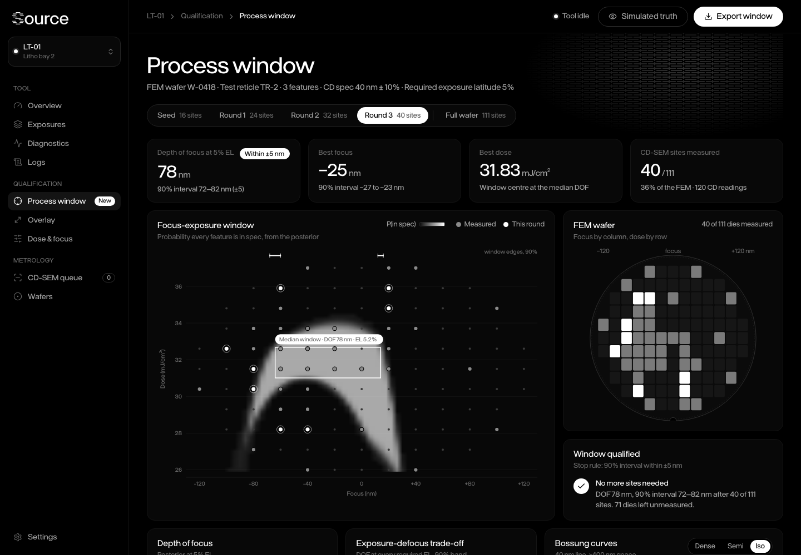

# Adaptive process-window qualification (Source Foundry concept)

**Live demo:** https://mohith26.github.io/source-foundry-process-window/

An unofficial concept feature for [Source Foundry](https://sourcefoundry.com), built by Mohith Gajjela. Not affiliated with Source Foundry. All data is synthetic.



## What it is

Source Foundry is building new lithography machines, and its trademark filings describe software "for operating, monitoring, controlling, calibrating, diagnosing, and optimizing" those tools. One of the first questions anyone asks of a new litho tool is: **what is its process window?** That is, how much focus error (depth of focus, DOF) can it tolerate while still printing every feature within spec over a usable dose range (exposure latitude, EL).

The standard way to answer it is a focus-exposure matrix (FEM): expose a wafer with focus stepped across columns and dose across rows, then measure critical dimensions (CD) on every die with a CD-SEM. Measuring every die of every FEM is slow, and during tool bring-up it happens over and over.

This demo is a **Process window** page for an imagined Source Foundry tool console that:

- **Measures only the dies that matter.** It starts from 16 space-filling dies, then picks batches of 8 that would narrow the DOF estimate the most.
- **Reports DOF with an honest interval.** Every number on the page (DOF, best focus, best dose, the window drawn on the chart) comes from a posterior, so the page says "78 nm, 90% interval 72 to 82 nm", not just "78 nm".
- **Stops when it is sure enough.** The run ends once the 90% interval on DOF is within ±5 nm.

## Headline result (100 simulated tools)

| Strategy | Sites measured | Mean DOF error | 90th pct error | 90% interval covers truth |
|---|---|---|---|---|
| Adaptive (this feature) | 40 | 2.8 nm | 4.2 nm | 89% |
| Space-filling grid | 40 | 4.2 nm | 8.0 nm | 95% |
| Seed + random | 40 | 4.0 nm | 8.0 nm | 89% |
| Full wafer | 111 | 2.5 nm | 4.0 nm | 93% |

With 40 of 111 dies (36% of the CD-SEM time), the adaptive run gets within 0.3 nm of measuring the whole wafer on average, and beats the same budget spent on a grid or at random. Reproduce with `node scripts/backtest.mjs 100` (about a minute); the page reads the result from `data/backtest.json`.

## How it works

1. **Simulated tool.** `makeTool(seed)` draws a tool and resist: three features (dense 80 nm pitch, semi-dense 120 nm pitch, isolated line), each with its own dose-to-size, dose slope, Bossung curvature that changes with dose (isofocal behaviour), best-focus offset, third and fourth order focus terms, and a pattern top-loss term past about 90 nm of defocus. CD-SEM noise is 0.55 to 0.9 nm. The top-loss term is deliberately outside the fitted model so the fit is not handed the true functional form.
2. **FEM layout.** 13 focus columns (-120 to +120 nm) by 11 dose rows (26.0 to 37.0 mJ/cm²) of 21 x 24 mm dies on a 300 mm wafer; dies that do not fit inside the 3 mm edge exclusion are not exposed, leaving 111.
3. **Bayesian Bossung model.** Per feature, CD is a 14-term polynomial in log-dose and focus with a normal-inverse-gamma prior; the posterior is conjugate, so refitting after each batch is exact and instant.
4. **Window per draw.** For each of 300 posterior draws, CD at every focus is a quadratic in log-dose, so the in-spec dose interval per feature is solved in closed form, intersected across features, and swept over focus ranges to find the widest focus range that keeps the required EL. The spread of those DOFs is the interval.
5. **Site selection.** A die's three CD readings are worth measuring if they are correlated with DOF across the posterior draws: score = sum over features of Cov(DOF, CD_k)² / (Var CD_k + sigma²), the linear-Gaussian information the readings carry about DOF. Batches are picked greedily: after each pick the covariance gets the exact rank-one (Sherman-Morrison) update, which does not depend on the yet-unmeasured value, and the draws are regenerated with the same random numbers.
6. **Stop rule.** Measure until the 90% interval on DOF is within ±5 nm.

All of this is in `core/pw.js` (no dependencies). The page (`index.html`, `app.js`) runs the campaign for tool #18 in your browser on load. Tool #18 was picked because its adaptive error (2 nm) is the backtest median, not because it looks best.

## Tests

```
node --test test/
```

11 tests: FEM layout geometry, the closed-form in-spec interval against a brute-force scan, the window search against a closed-form parabolic Bossung case, exact coefficient recovery, the Sherman-Morrison update against a refit, gamma quantiles, determinism, and an end-to-end check that adaptive beats random on 12 tools while keeping coverage.

## Honest limitations

- **Synthetic physics.** I do not know Source Foundry's exposure physics; the simulator is a generic optical-style Bossung model, and units (mJ/cm²) are placeholders. The method only needs CD as a smooth function of a dose-like and a focus-like knob, so it should carry over, but the numbers here are not predictions for any real tool.
- **One CD per die.** Real CD-SEM recipes measure many lines per die and features can fail outright (bridging, collapse). A production version would add a pass/fail likelihood and use per-die averages.
- **Model form.** If the true Bossung shape is far from a 14-term polynomial, intervals can be too narrow; the backtest shows 89% coverage for a nominal 90%, with the out-of-basis top-loss term present.
- **Greedy batches.** The batch rule holds the posterior mean fixed while picking (a "kriging believer" style approximation).
- **Tool shell is invented.** Source Foundry has no public product UI; the console layout, tool name, wafer IDs and navigation are made up. The visual design follows sourcefoundry.com (typeface, black canvas, white pill buttons, the dashed "S" wordmark and line-segment pattern).

## Novelty note

Searched for adaptive or Bayesian focus-exposure sampling. Closest prior art: KLA's patent US 9,891,538 ("Adaptive sampling for process window determination") samples defect-inspection locations nearest the current process-window edge, and Chris Mack's probabilistic process window (JM3 2023) accounts for metrology noise when computing the window. Neither picks CD-SEM sites by their expected information about DOF, or reports a posterior interval on DOF with a stop rule. Source Foundry has no public software product, so nothing like this is shipped by them.
